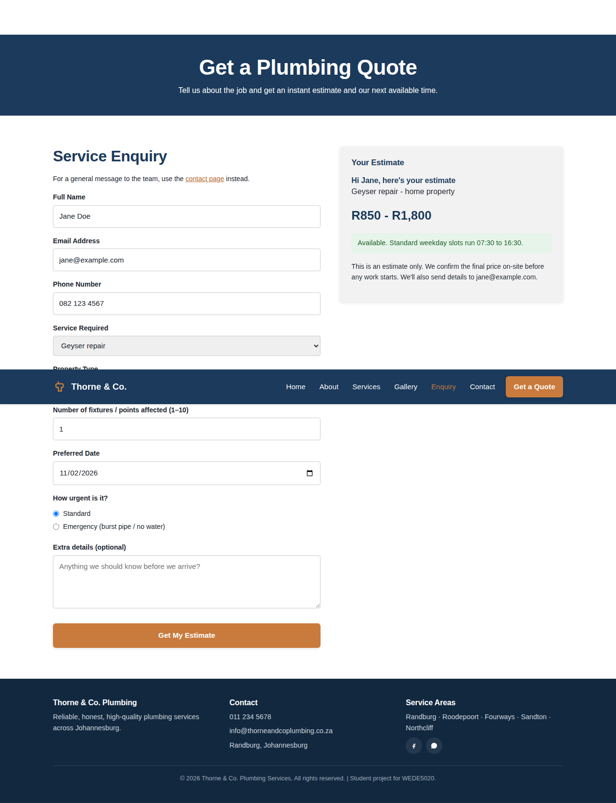
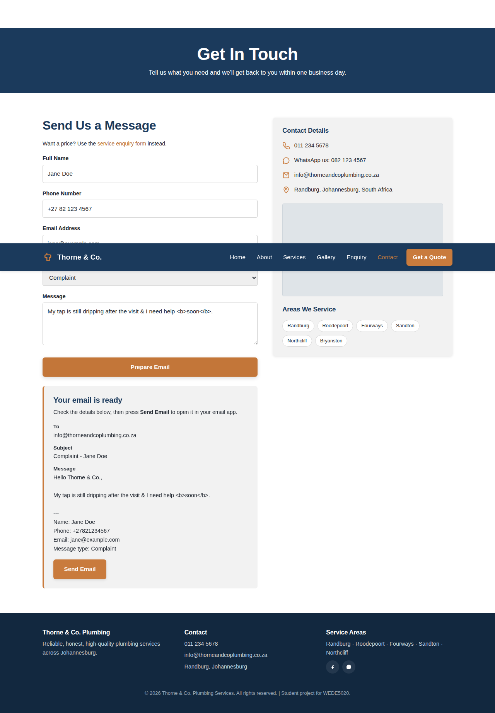
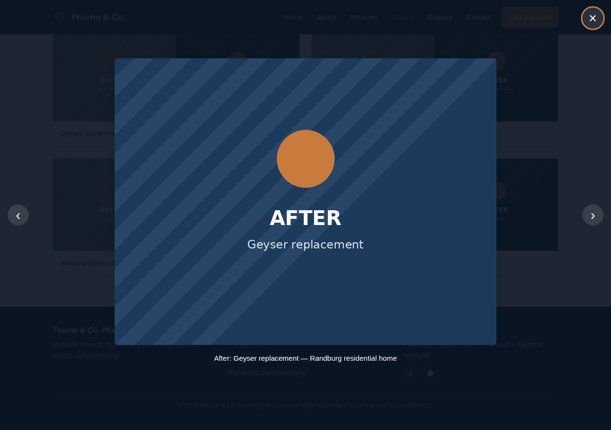
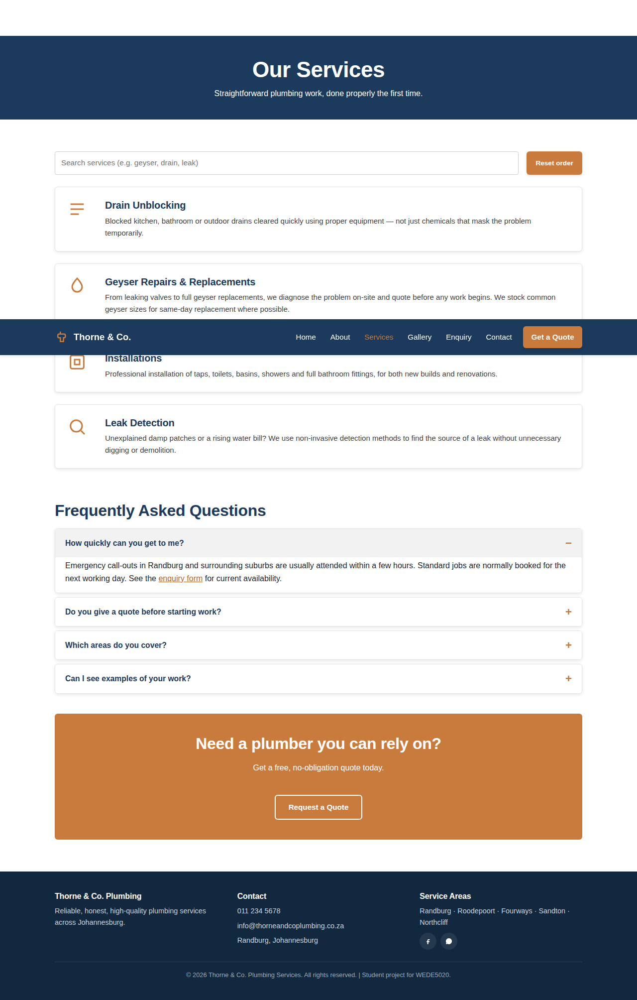

# Thorne & Co. Plumbing Services — Website

WEDE5020 Web Development
**Part 3 — Enhancing Functionality and SEO**

**Student Number:** 10450509

A six-page marketing/booking website for Thorne & Co. Plumbing Services. This part adds JavaScript functionality, HTML forms with validation, SEO, and deployment to a free hosting platform.

## Live pages

| Page | File |
|---|---|
| Home | `index.html` |
| About Us | `about.html` |
| Services | `services.html` |
| Gallery | `gallery.html` |
| Enquiry (quote + availability) | `enquiry.html` |
| Contact (general message) | `contact.html` |

## Project structure

```
thorne-co-website/
├── index.html
├── about.html
├── services.html
├── gallery.html
├── contact.html
├── enquiry.html
├── robots.txt
├── sitemap.xml
├── _headers               (security + cache headers for Netlify)
├── css/
│   └── style.css          (single external stylesheet, linked from every page)
├── js/
│   └── script.js           (nav, form validation, quote estimator, email builder, search, accordion, lightbox, map)
├── assets/
│   ├── img/                 (placeholder images used for the responsive image demos)
│   └── screenshots/         (breakpoint evidence for this README, see below)
└── README.md
```

## Part 3 — what was implemented

### JavaScript functionality
- **enquiry.html:** a service enquiry form (name, email, phone, service, property type, quantity, preferred date, urgency, notes). After validation the script works out an **estimated cost range** (extra fixtures, commercial and emergency surcharges) and the **availability** for the chosen date (weekday, Saturday, Sunday, same-day, emergency) and shows it next to the form. Prices are sample figures for the project, not real quotes.
- **contact.html:** a general message form (name, phone, email, message type, message). After validation the details are **compiled into an email** (to, subject, body shown in a preview) and a **Send Email** button opens it with a `mailto:` link to `info@thorneandcoplumbing.co.za`.
- **Interactive map:** Leaflet + OpenStreetMap map of the Randburg service area with a marker, popup and coverage circle (contact page).
- **Accordion:** FAQ section on the services page (animated open/close, keyboard accessible).
- **Dynamic content + search:** services page has a live search filter and an A–Z sort; the homepage loads extra reviews dynamically with a "Show more reviews" button (DOM created with JavaScript).
- **Gallery lightbox:** click any before/after photo to view it larger, with caption, next/previous buttons, arrow keys, Esc to close and focus handling.
- **Animations and transitions:** scroll-reveal fade-ins (IntersectionObserver), hover transitions, accordion and lightbox transitions. `prefers-reduced-motion` is respected.

### Forms: elements, validation and submission
- Elements used: `input` (text, email, tel, number, date, search, radio), `select`, `textarea`, `fieldset`/`legend`, labels linked with `for`/`id`.
- HTML5 validation attributes (`required`, `minlength`, `maxlength`, `min`, `max`, `type`) **plus** JavaScript validation with inline error messages: names (letters only), South African phone numbers (`0821234567` or `+27821234567`), email format, character limits, number range, and dates that cannot be in the past.
- `action` attributes: the contact form uses `action="mailto:info@thorneandcoplumbing.co.za"`, the enquiry form uses `action="enquiry.html#quote-result"`. JavaScript handles the submit so the user sees the validated result first.

### SEO
- **Keyword research:** target phrases such as "plumber Randburg", "geyser repairs Johannesburg", "leak detection", "drain unblocking" used in titles, headings, and body text.
- **Title tags and meta descriptions:** unique for every page, plus meta keywords, canonical URLs and Open Graph / Twitter tags.
- **Headings:** one `h1` per page, then `h2`/`h3` in order.
- **Images:** descriptive file names (`gallery-geyser-after.jpg`), meaningful `alt` text, `width`/`height` set, `loading="lazy"` on gallery images.
- **URLs:** clean, descriptive page names (`services.html`, `enquiry.html`).
- **Internal linking:** links between home, services, about, gallery, enquiry and contact in the page text as well as the nav.
- **Mobile-friendly:** responsive layout checked on all six pages (no horizontal scroll at 390px).
- **Local SEO:** `Plumber` / LocalBusiness structured data (JSON-LD) with Randburg address, phone and service areas on the home and contact pages.
- **robots.txt** and **sitemap.xml** added (replace the Netlify address inside them if your site URL is different).
- **Page speed:** one shared CSS and JS file, no frameworks, lazy-loaded images, cache headers in `_headers`.
- **Security:** Content-Security-Policy meta tag, `referrer` policy, user text only inserted with `textContent` (never `innerHTML`), input length limits, `X-Frame-Options`, `nosniff` and HSTS headers in `_headers`.
- **Off-page SEO plan** (done outside the code): create a Google Business Profile, list the business on local directories (Yellow Pages SA, Hotfrog) for backlinks, and post the website link and before/after photos on Facebook.

### Deployment (Netlify)
1. Push this folder to the GitHub repository (`git add .`, `git commit -m "Part 3: functionality and SEO"`, `git push`).
2. Log in to Netlify, choose **Add new site → Import an existing project**, connect GitHub and select the repository.
3. Leave the build command empty and set the publish directory to the folder containing `index.html`.
4. After it deploys, copy the live URL and replace `https://thorneandcoplumbing.netlify.app` in `sitemap.xml`, `robots.txt`, the canonical links and Open Graph tags if the address is different.
5. Live site URL: _add your Netlify link here_

### Testing notes for Part 3
- Enquiry form: empty submit (6 errors), invalid phone, past date, valid submit (estimate and availability shown).
- Contact form: valid submit builds the email; text such as `<b>` shows as plain text (not run as HTML).
- Services search ("drain" shows 1 result, nonsense shows the no-results message), sort A–Z, accordion.
- Gallery lightbox: open, next/previous with arrow keys, Esc to close.
- No JavaScript errors in the browser console on any page; no horizontal scrolling at 390px.

## Screenshot evidence






## Project Timeline and Milestones

Project timeline with the current status of each stage.

| Milestone | Target Timeframe | Status |
|---|---|---|
| Project proposal approval | Week 1 | Completed (done) |
| Wireframes, sitemap and asset sourcing finalised | Week 2 | Completed (done) |
| HTML structure for all pages completed | Week 3–4 | Completed (done) |
| CSS styling and responsive layout applied | Week 5 | Completed (done) |
| Content population, JavaScript functionality, SEO and testing | Week 6 | Completed (done) |
| Final review, deployment and submission | Week 7 | In progress (deploy to Netlify and add live link) |

### Milestones

- [x] Enquiry page with validated form, cost estimate and availability
- [x] Contact page with validated form and compiled email
- [x] Interactive map, accordion, search/sort, dynamic reviews, lightbox
- [x] Animations and transitions
- [x] SEO: titles, meta, headings, alt text, internal links, local SEO, robots.txt, sitemap.xml
- [x] Security headers and safe handling of user input
- [ ] Deploy to Netlify and add the live URL
- [ ] Replace placeholder images with real job photos

## Changelog

### Part 3 — Functionality and SEO

- **[NEW]** Created `enquiry.html` with a validated enquiry form that returns an estimated cost range and availability.
- **[CHANGED]** `contact.html` form now has a message-type dropdown, stricter validation (SA phone format, name and length rules) and builds a `mailto:` email with a preview and Send Email button.
- **[CHANGED]** Replaced the map placeholder on the contact page with an interactive Leaflet/OpenStreetMap map.
- **[CHANGED]** Gallery placeholders replaced with real `` elements (generated placeholder photos) and a lightbox viewer.
- **[NEW]** Services page: search box, A–Z sort and FAQ accordion.
- **[NEW]** Homepage: extra customer reviews loaded dynamically with JavaScript.
- **[NEW]** Added scroll-reveal animations and transitions (with reduced-motion support) in `style.css` and `script.js`.
- **[NEW]** Navigation: added an Enquiry link on every page and pointed the "Get a Quote" buttons to `enquiry.html`.
- **[SEO]** Added unique titles, meta descriptions, keywords, canonical, Open Graph tags, JSON-LD local business data, descriptive image names/alt text, internal links, `robots.txt` and `sitemap.xml`.
- **[SECURITY]** Added a Content-Security-Policy meta tag, `_headers` file, input length limits and safe text insertion (`textContent`).
- **[UPDATED]** Rewrote `script.js` into numbered sections; extended `style.css` with a Part 3 section.

### Part 2 feedback — corrections made (done in Part 3)

> *Replace the placeholders below with the actual lecturer comments from the Part 2 feedback so each entry shows the comment and the fix.*

- **[FIX]** _(placeholder)_ e.g. "Feedback: ... → Change made: ..."
- **[FIX]** _(placeholder)_ e.g. "Feedback: ... → Change made: ..."

## References

Google Search Central. (2025). *SEO starter guide*. https://developers.google.com/search/docs/fundamentals/seo-starter-guide

Leaflet. (2025). *Leaflet: an open-source JavaScript library for interactive maps*. https://leafletjs.com

MDN Web Docs. (2025). *Client-side form validation*. https://developer.mozilla.org/en-US/docs/Learn_web_development/Extensions/Forms/Form_validation

MDN Web Docs. (2025). *Content Security Policy (CSP)*. https://developer.mozilla.org/en-US/docs/Web/HTTP/CSP

Netlify. (2025). *Deploy sites from Git*. https://docs.netlify.com

OpenStreetMap contributors. (2025). *OpenStreetMap*. https://www.openstreetmap.org

Schema.org. (2025). *Plumber*. https://schema.org/Plumber
